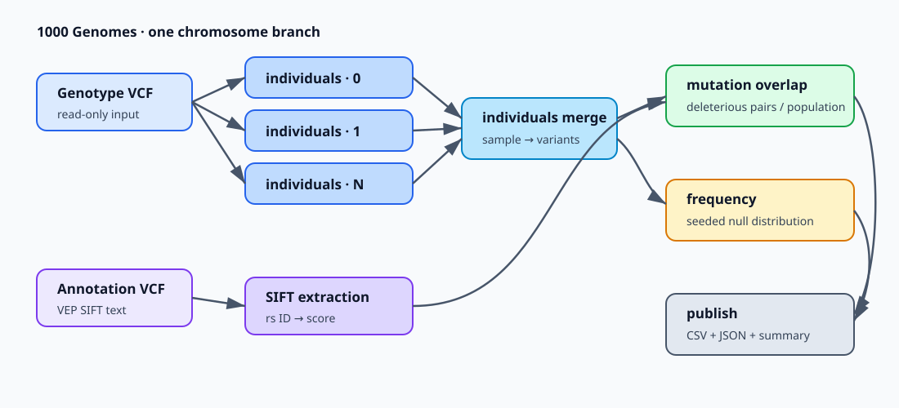
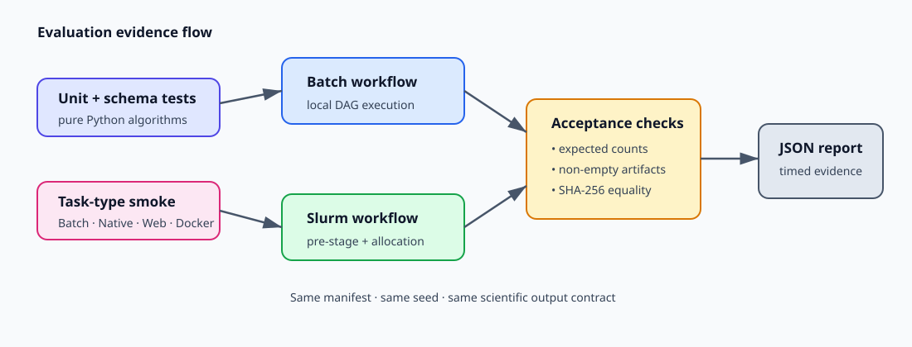
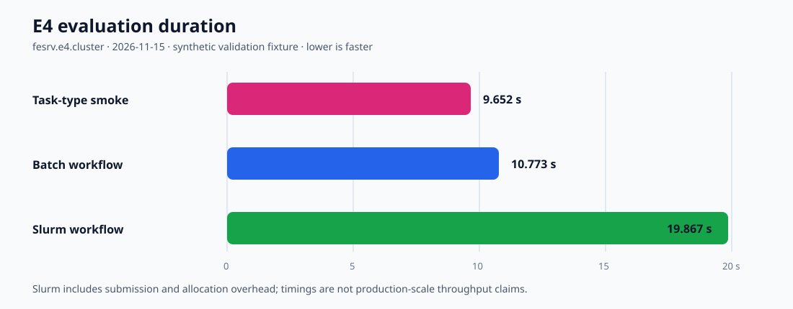
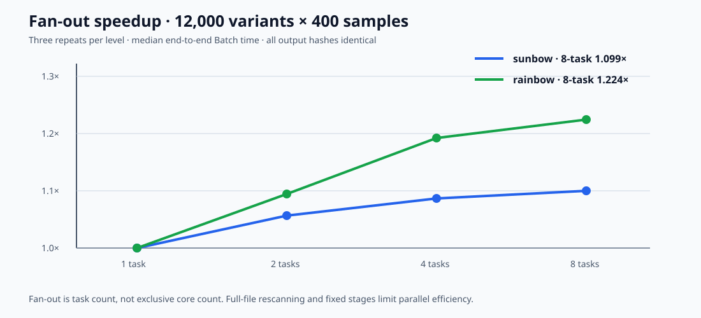

# 1000 Genomes on DAGonStar

A local, reproducible DAGonStar implementation of the classic
[1000 Genomes mutational-overlap workflow](https://github.com/pegasus-isi/1000genome-workflow).

## Workflow graph

The following graph is expanded independently for every chromosome and
population in the manifest:



The workflow is documented in detail under [`docs/`](docs/index.md):

- [architecture and execution profiles](docs/architecture.md);
- [input and output schemas](docs/schemas.md);
- [test and evaluation methodology](docs/evaluation.md);
- [recorded multi-host evaluation results](docs/evaluation-results.md);
- [scalability methodology and interpretation](docs/scalability.md).

The `individuals` stage is a configurable fan-out. DAGonStar discovers all
edges from the `workflow:///task/output` references in task commands and runs
independent branches concurrently.

## Requirements

- Python 3.10+
- A POSIX shell
- DAGonStar (installed by `requirements.txt`)

No scientific Python stack is required; the analysis tasks use the standard
library and stream VCF/VCF.GZ input.

## Quick start

```bash
python3 -m venv .venv
. .venv/bin/activate
python -m pip install -r requirements.txt
cp dagon.ini.sample dagon.ini
python workflow.py --manifest examples/demo/manifest.json --output output
```

The small checked-in fixture finishes in seconds. Results appear in `output/`:

- `chr1.ALL.overlap.csv`: pairwise shared deleterious variants;
- `chr1.ALL.frequency.json`: deterministic random-pair null distribution;
- `chr1.ALL.summary.json`: run metadata and aggregate counts.

DAGonStar task scratch directories are under `.dagon-scratch/`. Set
`remove_dir=True` in `dagon.ini` after debugging if they should be removed.

## Run real data

Create a JSON manifest (paths are resolved relative to the manifest):

```json
{
  "chromosomes": [
    {
      "name": "1",
      "genotypes": "data/ALL.chr1.vcf.gz",
      "annotations": "data/ALL.chr1.vep.vcf.gz"
    }
  ],
  "populations": {
    "ALL": "populations/ALL",
    "EUR": "populations/EUR"
  }
}
```

Population files contain one sample ID per line (whitespace is accepted).
Genotype VCF samples come from the `#CHROM` header. The annotation VCF should
contain VEP-style `CSQ` entries with SIFT predictions such as
`deleterious(0.01)` or `tolerated(0.42)`. Records without an `rs` identifier or
a numeric SIFT score are ignored.

```bash
python workflow.py \
  --manifest manifest.json \
  --individual-jobs 8 \
  --frequency-runs 10000 \
  --seed 42 \
  --output output
```

Useful options:

- `--genotype-mode carrier` includes any non-reference called allele;
- `--genotype-mode homozygous-alt` includes only homozygous alternate calls;
- `--max-individuals N` caps each population deterministically for smoke tests;
- `--dry-run` validates and prints the DAG without executing it.

Input paths and the publication directory must be visible on the execution
host. The default profile uses local `BATCH` tasks; the task graph and commands
can be switched to another DAGonStar task backend without changing the data
formats.

## DAGonStar execution profiles

The same graph supports local Batch tasks and current Slurm tasks:

```bash
# Local Batch tasks
python workflow.py --manifest manifest.json --executor batch --output output

# Slurm tasks with scheduler-aware pre-staging (enabled by default)
python workflow.py --manifest manifest.json --executor slurm \
  --partition debug --time 00:30:00 --memory-mb 4096 --output output
```

The Slurm profile uses DAGonStar's pre-staging feature to copy and verify
`workflow://` inputs before allocating compute resources. Disable it only for a
site-specific reason with `--no-pre-stage`.

In addition to the scientific graph, the evaluation suite exercises modern
DAGonStar task types with a credential-free Batch → Native → Web workflow and
an optional real Docker task.

## Evaluation



### Recorded performance



The latest recorded evaluation ran on `fesrv.e4.cluster` on 2026-11-15 using
Python 3.11.7, DAGonStar 2.9.4, Slurm 23.11.3, and the `debug` partition.

| Scenario | DAGonStar task types | Result | Duration |
|---|---|---:|---:|
| Unit suite | pure Python | passed | 0.191 s |
| DAG dry-run | graph construction | passed | 0.059 s |
| Task-type smoke | Batch → Native → Web | passed | 9.652 s |
| Complete local workflow | Batch | passed | 10.773 s |
| Complete scheduled workflow | Slurm with pre-staging | passed | 19.867 s |

Batch and Slurm produced byte-identical deterministic artifacts. The Slurm
duration includes scheduler submission and allocation overhead. These timings
use the tiny synthetic fixture—four individuals, three annotated variants, two
populations, and 100 frequency runs—so they validate behavior and executor
reproducibility, not production-scale throughput. Full environment details,
hashes, limitations, and the remote report location are recorded in the
[E4 evaluation results](docs/evaluation-results.md).

### Scalability and speedup



The same deterministic 12,000-variant × 400-sample workload was run three
times per fan-out level on two 24-logical-CPU hosts. Values are median
end-to-end Batch workflow wall time; `S(n) = T(1) / T(n)`.

| Host | Fan-out | Median time | Speedup | Efficiency |
|---|---:|---:|---:|---:|
| `sunbow` | 1 | 10.903 s | 1.000× | 100.0% |
| `sunbow` | 2 | 10.322 s | 1.056× | 52.8% |
| `sunbow` | 4 | 10.031 s | 1.087× | 27.2% |
| `sunbow` | 8 | 9.917 s | 1.099× | 13.7% |
| `rainbow` | 1 | 14.407 s | 1.000× | 100.0% |
| `rainbow` | 2 | 13.163 s | 1.095× | 54.7% |
| `rainbow` | 4 | 12.079 s | 1.193× | 29.8% |
| `rainbow` | 8 | 11.767 s | 1.224× | 15.3% |

All fan-out levels produced identical scientific-output hashes. Scaling is
positive but sublinear because each `individuals` shard still scans and parses
the complete VCF, while merge, analysis, publication, and DAG lifecycle costs
remain fixed. Fan-out is a task count, not an exclusive CPU-core count. See
[the scalability guide](docs/scalability.md) for the full protocol and
limitations.

Run the complete local evaluation:

```bash
python evaluation/run_suite.py --config dagon.ini
```

On a Slurm host:

```bash
python evaluation/run_suite.py --config /absolute/path/dagon.ini --partition debug
```

Add `--docker` when Docker daemon access is available. Reports include the
environment, command, duration, bounded logs, expected-value checks, and output
SHA-256 values. When Slurm is enabled, deterministic Batch and Slurm artifacts
must be byte-identical. See [the evaluation guide](docs/evaluation.md).

## Development

```bash
python -m unittest discover -s tests -v
python -m compileall -q genome_workflow evaluation workflow.py
```

The task CLI can also be run directly with `python -m genome_workflow.tasks
--help`, which makes individual stages easy to test outside DAGonStar.

## Provenance

The graph follows the public Pegasus 1000 Genomes benchmark workflow. The
implementation here is original Python 3 code and uses DAGonStar's documented
Python task API and `workflow://` data references.
