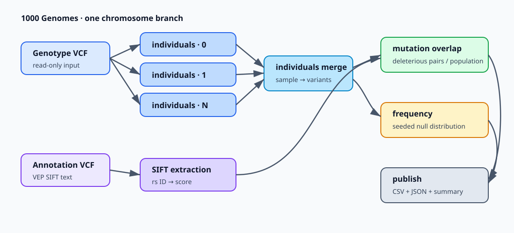
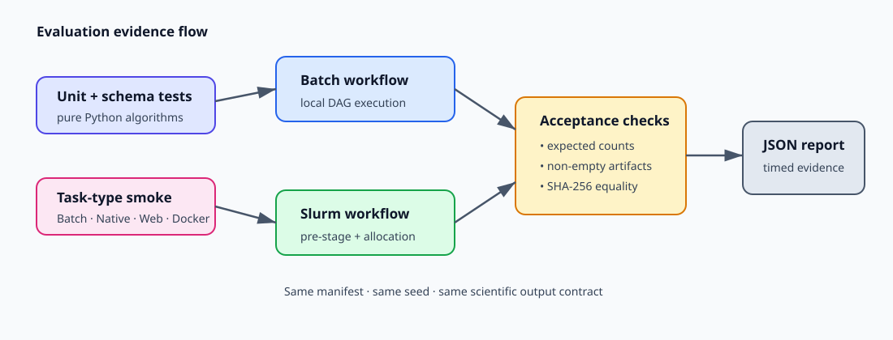

# Architecture

## Scientific graph

Each chromosome creates `N` independent individual-extraction tasks. Records
are assigned by `record_index modulo N`, so every variant is processed exactly
once without requiring a preliminary record-count pass. The merge task unions
variant identifiers per sample. SIFT extraction runs concurrently because it
depends only on the annotation VCF.

For every population, mutation overlap consumes the merged carrier map and the
SIFT map. Frequency consumes the merged carrier map without applying SIFT,
matching the null-distribution role in the original benchmark. A final publish
task waits for both analyses and copies stable artifacts to the requested
output directory.

## Execution profiles

| Profile | DAGonStar type | Intended use | Current feature |
|---|---|---|---|
| `batch` | `TaskType.BATCH` | workstation, CI, login-node fixture | concurrent local tasks |
| `slurm` | `TaskType.SLURM` | HPC production/evaluation | scheduler-aware pre-staging |
| task-type smoke | Batch + Native + Web | API compatibility | staged Native bindings and structured Web outputs |
| optional container smoke | `TaskType.DOCKER` | container-capable host | isolated current Python image |

The Slurm profile passes `pre_stage=True` to the workflow and every Slurm task.
DAGonStar therefore stages and verifies `workflow://` inputs on the submission
host before requesting compute time. The compute-side launcher rechecks staged
identity before executing.

## Data lifecycle

Input data is read-only. Intermediate JSON lives in isolated DAGonStar scratch
directories. Only population-level CSV/JSON and evaluation evidence are
published. Production inputs and scratch paths must be visible from the host
that executes the selected task type.

## Determinism

- Variant and sample keys are sorted before JSON serialization.
- JSON is written atomically through a temporary file and rename.
- Frequency sampling uses a user-supplied seed.
- Evaluation compares Batch and Slurm artifact SHA-256 hashes.
- Population ordering follows the supplied population file.
