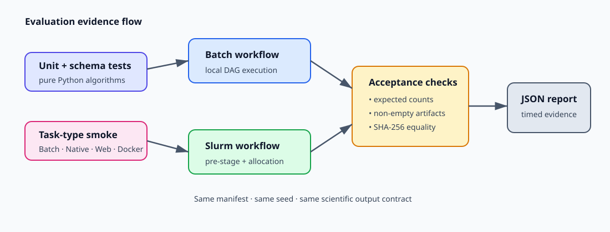

# Evaluation suite

## Goals

The suite checks scientific correctness, DAG construction, current DAGonStar
task APIs, local execution, scheduler execution, and cross-executor
reproducibility. It does not claim production scalability from the tiny fixture.



## Matrix

| Scenario | Evidence | Pass condition |
|---|---|---|
| unit | streaming parser and analysis tests | every `unittest` passes |
| dry-run | manifest and graph expansion | command exits zero |
| task types | Batch → Native → Web and optional Docker | declared artifacts exist |
| Batch workflow | complete demo DAG | expected pair/run counts and non-empty artifacts |
| Slurm workflow | complete demo DAG on real scheduler | same checks as Batch |
| reproducibility | artifact SHA-256 | deterministic Batch/Slurm artifacts match |

## Local execution

```bash
python evaluation/run_suite.py --config dagon.ini
```

Add `--docker` only when the account can access the Docker daemon.

## Slurm execution

Use a scratch base on a shared filesystem visible to login and compute nodes:

```ini
[batch]
scratch_dir_base=/shared/path/dagon-scratch
remove_dir=False
threads=4

[slurm]
partition=debug
```

Then run:

```bash
python evaluation/run_suite.py \
  --config /absolute/path/dagon.ini \
  --partition debug
```

The suite enables scheduler-aware pre-staging. It writes timestamped evidence
under `evaluation/results/<host>-<UTC timestamp>/` and refreshes
`evaluation/results/latest.json`.

## Interpreting failures

- Unit failures indicate scientific or schema regressions.
- Task-type failures indicate DAGonStar API/runtime incompatibility.
- Batch-only failures usually indicate installation, paths, or permissions.
- Slurm-only failures usually indicate partition, shared scratch, module, or
  compute-node environment issues.
- Hash mismatch means the two executors produced different scientific output
  even if both completed; treat it as a failed evaluation.

The validator allows up to 30 seconds for published files to become visible.
This accommodates metadata propagation on shared/distributed filesystems after
the scheduler reports a successful task, without hiding a genuinely missing
artifact.

Never commit host-specific result reports: they may contain usernames, paths,
and scheduler details.

## Scalability and speedup

Generate a deterministic scaling fixture and run repeated fan-out levels:

```bash
python evaluation/generate_scaling_fixture.py \
  --output scaling-fixture --variants 12000 --samples 400

python evaluation/scalability.py \
  --config dagon.ini \
  --fixture scaling-fixture \
  --output evaluation/scalability \
  --levels 1 2 4 8 \
  --repeats 3
```

See [the scalability guide](scalability.md) for formulas, acceptance rules,
limitations, and the recorded multi-host results.
